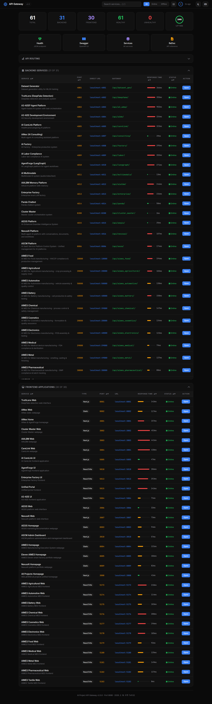
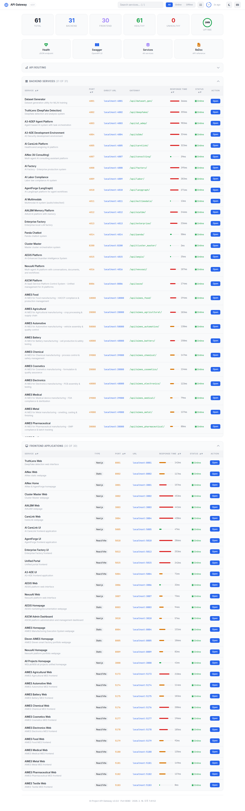
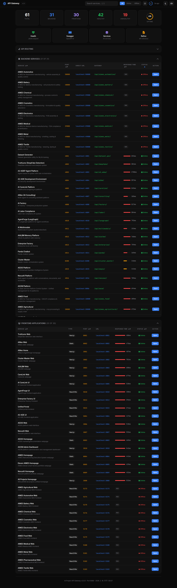
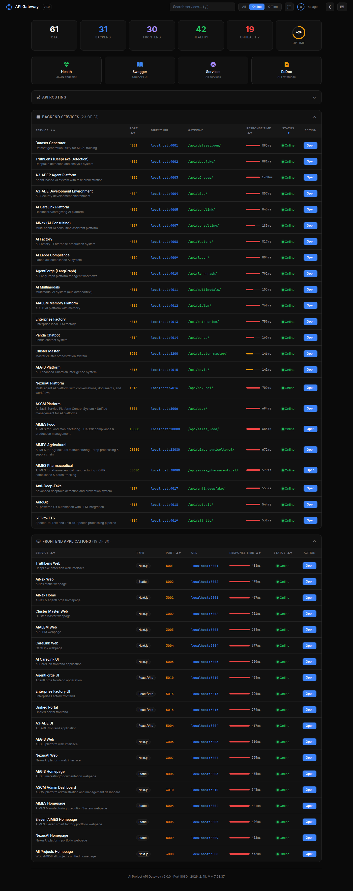
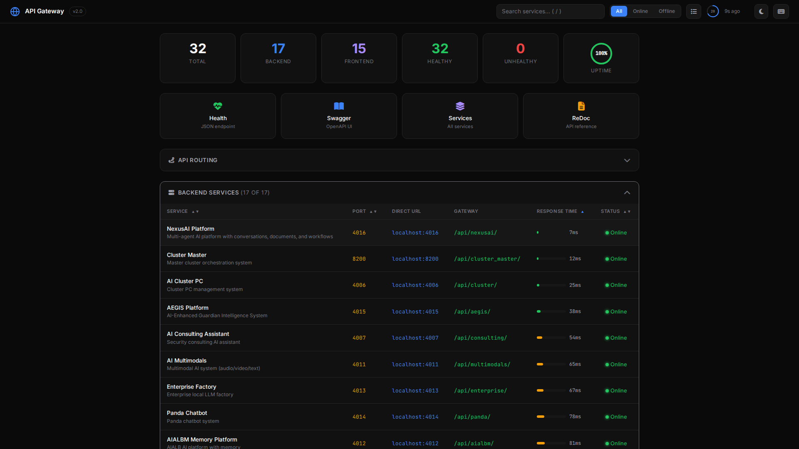
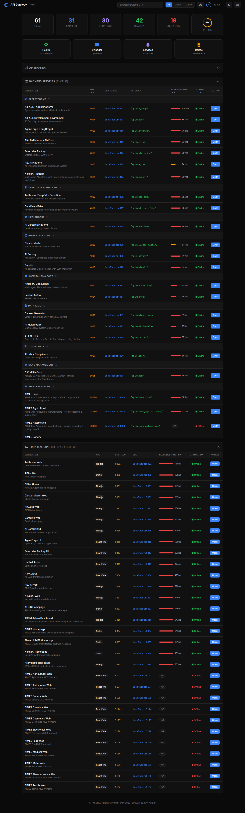
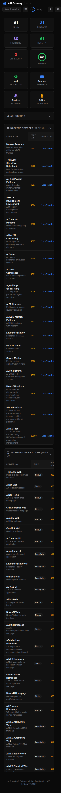
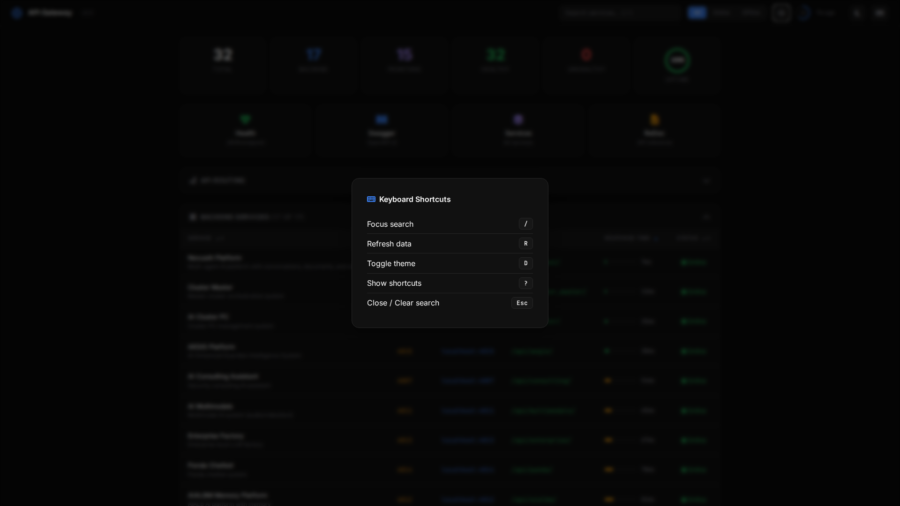

# AI Project API Gateway

> 61개 마이크로서비스(Backend 26 + Frontend 34 + Gateway 1)를 단일 엔드포인트로 통합 관리하는 API Gateway. 서비스 레지스트리는 32개 승인 프로젝트 폴더 기준으로 재구성됨.

**Version:** 2.2.0
**Port:** 8080
**Author:** Brian Lee
**Last Update:** Oct. 15, 2026 (2026-06-06 워킹트리 변경분 반영, 미커밋)



---

## 목차

- [개요](#개요)
- [아키텍처](#아키텍처)
- [빠른 시작](#빠른-시작)
- [디렉토리 구조](#디렉토리-구조)
- [파일 설명](#파일-설명)
  - [Python 스크립트](#python-스크립트)
  - [Shell 스크립트](#shell-스크립트)
  - [기타 파일](#기타-파일)
- [서비스 목록](#서비스-목록)
  - [Backend Services](#backend-services)
  - [Frontend Services](#frontend-services)
- [API 엔드포인트](#api-엔드포인트)
- [대시보드](#대시보드)
- [로그](#로그)
- [트러블슈팅](#트러블슈팅)
- [기술 스택](#기술-스택)

---

## 개요

AI Project API Gateway는 다수의 AI/ML 마이크로서비스를 하나의 진입점(`:8080`)으로 묶어 주는 리버스 프록시 겸 관리 대시보드이다.

주요 기능:

- **리버스 프록시** - `/api/{service}/{path}` 패턴으로 모든 백엔드 서비스에 요청 전달
- **헬스 체크** - 전체 서비스의 상태를 비동기로 병렬 점검
- **웹 대시보드** - 실시간 서비스 상태, 응답시간, 검색/필터, 다크/라이트 테마 지원
- **OpenAPI 문서** - Swagger UI(`/swagger`) 및 ReDoc(`/redoc`) 자동 생성
- **서비스 관리 스크립트** - 전체 서비스 일괄 시작/중지/상태 확인
- **Auto-Recovery (옵트인)** - `GATEWAY_AUTO_RECOVERY=1` 로 활성화 시 Offline 전환 서비스를 자동 재시작하고 헬스 폴링으로 기동을 검증 (쿨다운 120초, 최대 5회)
- **API 키 보호 (옵션)** - `GATEWAY_API_KEY` 설정 시 프록시(`/api/*`)와 `/auto-recovery/reset` 에 `X-API-Key` 헤더 요구, CORS 는 `GATEWAY_CORS_ORIGINS` 허용 목록

---

## 최근 업데이트 (2026-10-15 기준)

### 2026-06-06 — v2.2.0 레지스트리 전면 재구성 + 헬스체크/프록시 정직성 수정 + 테스트 하니스 (워킹트리 변경, 미커밋)

근거: `reports/API_Gateway_Report_2026-06-06.md` (누락 기능 6건 + 감사 Gap 19건 = 25건 중 23건 해결, 2건 범위 외 명시). 변경 파일: `api_gateway_v2.py`, `start_gateway.sh`, `status_services.sh`, `SERVICE_STATUS.md`, 신규 `tests/`, `reports/`.

**서비스 레지스트리 (`api_gateway_v2.py`)**
- 폐기 경로(`ai_factory`, `a3de`, `ai_labor`, `webpage_*` 등)를 제거하고 **32개 승인 프로젝트 폴더 기준 Backend 26 + Frontend 34** 로 전면 재작성 (포트 충돌 0건). 각 백엔드 엔트리에 `scheme` 과 정규 **`health` 경로** 필드 추가, `SERVICE_CATEGORIES` 9 → **14개 그룹**, `API_DOCS` 를 26개 백엔드 전부에 생성("No docs" 제거), Auto-Recovery 기동 명령표도 신규 레지스트리로 교체.
- 대시보드 예시 타일을 `truthlens` / `carelink` / `ascm` / `agentforge` 로 갱신, 버전 표기 2.2.0 통일.

**헬스체크 · 프록시 정직성**
- `check_service_health(health_path=…)`: 레지스트리의 `health` 경로를 우선 프로빙한 뒤 `/health`, `/api/health`, `/`, `/api/` 폴백. **503 을 healthy 로 간주하던 사일런트 폴백 제거**(2xx/401/403 만 healthy), 리다이렉트 추적(`follow_redirects=True`). `health_check_single` 도 `basePath`/`scheme`/`health` 를 동일하게 전달.
- `proxy_request()`: per-service `scheme` 사용(`http://localhost` 하드코딩 제거), 원본 바이트·Content-Type·헤더를 **충실 패스스루**(JSON 래핑/헤더 유실 제거), `X-Proxied-From` 헤더 부여, 예외는 `logger.exception` 후 일반화된 502.

**Auto-Recovery**
- 기본 **OFF**(`GATEWAY_AUTO_RECOVERY=1` 로 옵트인) — 60개 다운스트림 dev 서버 난립 방지. `restart_service()` 는 재시작 후 최대 12초 헬스 폴링으로 실제 기동을 검증해 가짜 성공을 보고하지 않음. 폐기된 `@app.on_event` 를 `lifespan` 컨텍스트로 이전.

**실행 환경**
- pyenv `python3` 의 uvloop/httptools 세그폴트 회피: 진입점이 `loop=asyncio`, `http=h11` 을 강제하고, `start_gateway.sh` 는 `GATEWAY_PYTHON`(기본 `/usr/bin/python3`) 으로 `PYTHONPATH`/`VIRTUAL_ENV` 를 제거한 clean env 에서 기동.
- `status_services.sh` 를 게이트웨이 `/health` 기반으로 재작성(하드코딩 포트 목록 제거, 항상 레지스트리와 동기화; 인자로 게이트웨이 URL 지정 가능).
- `SERVICE_STATUS.md` 를 2026-06-06 라이브 스냅샷(61/61 Online)으로 재생성.

**테스트 하니스 · 보고서 (신규)**
- `tests/gateway_test_suite.py`: 실행 중인 게이트웨이 대상 **E2E 17 케이스 + A/B(직접 헬스 vs 프록시 패스스루 지연 비교) + Chaos 6 케이스**(다운 백엔드 프록시, 미등록 서비스, 적대적 경로, 120 동시 요청, 생존성, OPTIONS) 를 순차 실행하고 JSON 을 산출. 최종 결과 **23/23 PASS** (`reports/gateway_test_results_final.json`).
- `reports/`: 감사·테스트 보고서, 대시보드 스크린샷 2장(초기/전 서비스 Online), 테스트 결과 JSON 3종.

**알려진 한계**
- 프록시는 백엔드 전용(프런트엔드는 헬스체크/대시보드 대상만). 일괄 기동 스크립트(`start_all_services.sh` 계열)는 구 레지스트리 기준이라 범위 외로 남아 있으며 `start_gateway.sh` 가 지원 진입점.

---

## 아키텍처

```
                         ┌─────────────────────┐
                         │   Web Dashboard      │
                         │   localhost:8080      │
                         └────────┬─────────────┘
                                  │
                    ┌─────────────┴──────────────┐
                    │    API Gateway (FastAPI)     │
                    │    Reverse Proxy + Health    │
                    └─────────────┬──────────────┘
                                  │
              ┌───────────────────┼───────────────────┐
              │                   │                    │
     ┌────────┴────────┐ ┌───────┴───────┐  ┌────────┴────────┐
     │  Backend (26)   │ │ Frontend (34) │  │  (incl. Static) │
     │  :4001 - :4019  │ │ :3001 - :5183 │  │   :8001 - :8009 │
     │  :8200,:18-58K  │ │               │  │                 │
     └─────────────────┘ └───────────────┘  └─────────────────┘
```

---

## 빠른 시작

```bash
# Gateway만 시작
./start_gateway.sh

# 전체 서비스(60개) + Gateway 시작
./start_all_services.sh

# 서비스 상태 확인
./status_services.sh

# 전체 서비스 중지
./stop_all_services.sh
```

시작 후 접속:

| 항목 | URL |
|------|-----|
| 대시보드 | <http://localhost:8080> |
| 헬스 체크 | <http://localhost:8080/health> |
| Swagger UI | <http://localhost:8080/swagger> |
| ReDoc | <http://localhost:8080/redoc> |
| 서비스 목록 (JSON) | <http://localhost:8080/services> |
| API 문서 | <http://localhost:8080/docs/api> |

---

## 디렉토리 구조

```
API_Gateway/
├── api_gateway_v2.py        # 메인 게이트웨이 애플리케이션 (v2.0)
├── api_gateway.py           # 레거시 게이트웨이 (v1.0, 보관용)
├── start_gateway.sh         # Gateway 단독 시작 스크립트
├── start_all_services.sh    # 전체 서비스 일괄 시작 스크립트
├── stop_all_services.sh     # 전체 서비스 일괄 중지 스크립트
├── status_services.sh       # 서비스 상태 확인 스크립트
├── SERVICE_STATUS.md        # 서비스 레지스트리 문서
├── favicon.ico              # 브라우저 탭 아이콘
├── README.md                # 이 문서
└── __pycache__/             # Python 바이트코드 캐시 (자동 생성)
```

---

## 파일 설명

### Python 스크립트

#### `api_gateway_v2.py` (메인 애플리케이션)

현재 사용 중인 API Gateway v2.0. FastAPI 기반의 비동기 웹 애플리케이션이다.

**구성 요소:**

| 섹션 | 설명 |
|------|------|
| `BACKEND_SERVICES` | 26개 백엔드 서비스 정의 (이름, 포트, 경로, 진입점, scheme, health) |
| `FRONTEND_SERVICES` | 34개 프론트엔드 서비스 정의 (이름, 포트, 타입) |
| `API_DOCS` | 백엔드 26개 전부에 대한 API 엔드포인트 문서 (정규 헬스 경로 포함) |
| `SERVICE_CATEGORIES` | 서비스 카테고리 분류 14개 그룹: AI Platforms(6), Documents & Files(5), Detection & Analysis(1), Healthcare(1), Manufacturing (MES)(12), Automation & Agents(3), Finance / Quant(1), LLMOps(1), Security(1), Gaming(1), SaaS Management(1), Assistants(1), Edge / IoT(2), Strategy / Games(1) |
| `check_service_health()` | 개별 서비스 헬스 체크 (레지스트리 `health` 경로 우선 → `/health`, `/api/health`, `/`, `/api/` 폴백; 2xx/401/403 만 healthy, 503 은 unhealthy, 리다이렉트 추적) |
| `auto_recovery_loop()` / `restart_service()` | 옵트인 자동 복구 모니터 (`GATEWAY_AUTO_RECOVERY=1`), 재시작 후 헬스 폴링으로 기동 검증 |
| `lifespan()` | FastAPI lifespan 컨텍스트 — 자동 복구 태스크 기동/정리 |
| `check_all_services()` | 전체 서비스 병렬 헬스 체크 (`asyncio.gather`) |
| `DASHBOARD_HTML` | 웹 대시보드 HTML/CSS/JS 전체 (인라인 SPA) |
| `root()` | 대시보드 렌더링 - 서비스 데이터를 JSON으로 HTML에 주입 |
| `proxy_request()` | `/api/{service}/{path}` 리버스 프록시 - 모든 HTTP 메서드 지원, per-service `scheme`, 바이트/헤더 충실 패스스루, `X-Proxied-From` 헤더 |

**대시보드 기능:**

- 다크/라이트 테마 토글 (`localStorage` 저장)
- 서비스 검색/필터 (이름, 설명, 포트 매칭, 150ms 디바운스)
- 상태 필터 (All/Online/Offline 버튼)
- 테이블 정렬 (Service, Port, Response Time, Status 컬럼)
- 서비스 상세 패널 (행 클릭 시 API 문서 확장)
- 카테고리 그룹 뷰 (플랫/그룹 토글)
- 응답시간 시각화 (색상 바 + 스파크라인 히스토리)
- 상태 변경 토스트 알림 (Online/Offline 전환 감지)
- Fetch 에러 배너 (데이터 수집 실패 시)
- Offline 서비스 N/A 배지
- 모바일 반응형 (768px/480px 브레이크포인트)
- 키보드 단축키 (`/`, `R`, `D`, `?`, `Esc`)
- 행 수 표시 `(N of M)` 형식
- **Open 버튼** - 각 서비스 행의 Action 컬럼에서 클릭 시 해당 서비스를 새 브라우저 탭으로 열기
- 30초 자동 새로고침 카운트다운 (SVG 원형 프로그레스)
- Uptime 퍼센트 SVG 링
- 접이식 섹션 (`localStorage` 상태 저장)
- 스켈레톤 로딩 애니메이션

**실행:**

```bash
/usr/bin/python3 api_gateway_v2.py        # 진입점이 loop=asyncio, http=h11 강제 (pyenv uvloop 세그폴트 회피)
# 또는
uvicorn api_gateway_v2:app --host 0.0.0.0 --port 8080 --loop asyncio --http h11
```

**환경변수:**

| 변수 | 기본값 | 설명 |
|------|--------|------|
| `GATEWAY_HOST` | `0.0.0.0` | 바인드 호스트 |
| `GATEWAY_API_KEY` | _(비어 있음)_ | 설정 시 프록시(`/api/*`)·`/auto-recovery/reset` 에 `X-API-Key` 요구 |
| `GATEWAY_CORS_ORIGINS` | localhost 허용 목록 | 콤마 구분 CORS 오리진 |
| `GATEWAY_AUTO_RECOVERY` | `0` | `1` 이면 Offline 서비스 자동 재시작 모니터 가동 |
| `GATEWAY_PYTHON` | `/usr/bin/python3` | `start_gateway.sh` / `status_services.sh` 가 사용할 인터프리터 |

---

#### `api_gateway.py` (레거시 v1.0)

v1.0 게이트웨이. v2.0으로 대체되어 더 이상 사용하지 않으나 참고용으로 보관 중이다.

**v1.0 vs v2.0 차이점:**

| 항목 | v1.0 | v2.0 |
|------|------|------|
| 대시보드 | JSON 응답 | 풀 웹 UI (HTML/CSS/JS) |
| 헬스 체크 | 순차 실행 | 비동기 병렬 실행 (`asyncio.gather`) |
| 응답시간 | 미측정 | ms 단위 측정 |
| 프론트엔드 서비스 수 | 15개 (일부 미확인 포트) | 15개 (실제 운영 서비스) |
| OpenAPI 문서 | 기본 | Swagger + ReDoc + 서비스별 문서 |
| favicon | 미지원 | 지원 |

---

### Shell 스크립트

#### `start_gateway.sh` - Gateway 단독 시작

API Gateway만 시작하는 스크립트. 백엔드/프론트엔드 서비스는 시작하지 않는다.

**동작 순서:**

1. 기존 Gateway 프로세스 중복 실행 여부 확인
2. `GATEWAY_PYTHON`(기본 `/usr/bin/python3`) 으로 의존성 검사 및 자동 설치 (`fastapi`, `httpx`, `uvicorn`)
3. `PYTHONPATH`/`VIRTUAL_ENV` 를 제거한 clean env 에서 `nohup`으로 백그라운드 실행 (진입점이 `loop=asyncio`, `http=h11` 강제)
4. 프로세스 기동 확인 후 URL/PID 정보 출력

**로그 위치:** `/tmp/api_gateway.log`

```bash
./start_gateway.sh
# 중지: pkill -f api_gateway_v2.py
```

---

#### `start_all_services.sh` - 전체 서비스 일괄 시작

61개 서비스(Backend 26 + Frontend 34 + Gateway 1)를 순차적으로 시작한다. (게이트웨이만 단독 실행 시 `./start_gateway.sh`)

> **주의 (2026-10-15):** 이 스크립트와 `10_/172_/192_` 변형은 아직 **구 레지스트리**(deepfake/a3de/cluster_master 등 폐기 경로) 기준이며 v2.2.0 레지스트리로 갱신되지 않았다(범위 외). 현재 지원되는 진입점은 `./start_gateway.sh` 이고, 다운스트림 서비스는 각 프로젝트에서 개별 기동한다. 아래 표는 구 스크립트의 동작을 설명한다.

**동작 순서:**

1. 각 서비스의 포트 사용 여부 확인 (이미 사용 중이면 SKIP)
2. 서비스별 작업 디렉토리로 이동 후 `nohup`으로 백그라운드 실행
3. PID 확인으로 기동 성공/실패 판정
4. 전체 시작 후 5초 대기, Gateway 헬스 체크로 최종 확인

**서비스별 실행 방식:**

| 유형 | 서비스 | 실행 명령 |
|------|--------|-----------|
| Streamlit | dataset_gen | `streamlit run main.py --server.port 4001` |
| Uvicorn | deepfake, a3de, carelink 등 13개 | `uvicorn {module}:app --host 0.0.0.0 --port {port}` |
| Flask-SocketIO | multimodals | `python -c "import app; socketio.run(...)"`|
| Docker | aimes_food | `docker compose up -d` |
| Node.js | aimes_agricultural 등 10개 AIMES GW | `env PORT={port} node src/index.js` |
| Python HTTP | truthlens, webpage_ainex 등 5개 | `python3 -m http.server {port}` |
| Next.js | ainex_home, cluster_master_web 등 8개 | `npx next dev -p {port}` |
| Vite | langgraph_frontend 등 4개 + AIMES 11개 | `npx vite --port {port} --host` |

**출력 예시:**

```
  [OK]   deepfake (port 4002, PID 12345)
  [SKIP] cluster (port 4006 already in use)
  [FAIL] panda (port 4014) - check /tmp/panda.log
```

**로그 위치:** `/tmp/{service_name}.log`

---

#### `stop_all_services.sh` - 전체 서비스 일괄 중지

모든 관련 프로세스를 타입별로 종료한다.

**종료 대상 (순서):**

1. Streamlit 서버 (`pkill -f "streamlit run"`)
2. Python HTTP 서버 (`pkill -f "python3 -m http.server"`)
3. Uvicorn 서버 (`pkill -f "uvicorn"`)
4. Flask-SocketIO (`pkill -f "import app as a"`)
5. Node.js 개발 서버 (`npm run dev`, `next dev`, `next-server`, `vite`)
6. API Gateway (`pkill -f "api_gateway_v2"`)

종료 후 등록된 포트를 순회하며 아직 사용 중인 포트가 있는지 확인하고 경고를 출력한다.

---

#### `status_services.sh` - 서비스 상태 확인

게이트웨이 `/health`를 조회하여 모든 등록 서비스의 실행 상태를 색상 표시한다.

**동작:** (하드코딩 포트 목록 없음 — 게이트웨이 레지스트리와 항상 동기화)

1. `GET {GATEWAY_URL}/services` 로 게이트웨이 도달 여부 확인 (미기동 시 `./start_gateway.sh` 안내 후 종료)
2. `GET /health` 결과를 Backend(26) / Frontend(34) 섹션별 표로 출력 (SERVICE, PORT, STATUS, RT(ms), ENDPOINT)
3. Online(초록) / Offline(빨강) 색상 구분
4. `Total: N/61 Online (Backend a/26, Frontend b/34, Gateway 1/1)` 요약

```bash
./status_services.sh                        # 기본 http://localhost:8080
./status_services.sh http://127.0.0.1:8080  # 게이트웨이 URL 지정
```

**출력 예시:**

```
=== Backend Services (26) ===
  SERVICE                        PORT  STATUS     RT(ms)  ENDPOINT
  agentforge                     8003  Online        2.6  /api/health
  ...
Total: 61/61 Online  (Backend 26/26, Frontend 34/34, Gateway 1/1)
```

---

### 기타 파일

| 파일 | 설명 |
|------|------|
| `SERVICE_STATUS.md` | 서비스 레지스트리 라이브 스냅샷 (2026-06-06, 61/61 Online). 각 서비스별 포트·헬스 경로·상태 |
| `tests/gateway_test_suite.py` | E2E 17 + A/B + Chaos 6 테스트 하니스. `/usr/bin/python3 tests/gateway_test_suite.py [BASE_URL] [--json OUT]` |
| `reports/` | `API_Gateway_Report_2026-06-06.md`(감사·Gap 보고서), 테스트 결과 JSON, 대시보드 스크린샷 |
| `favicon.ico` | 브라우저 탭에 표시되는 아이콘 (1.8KB). 대시보드 접속 시 `/favicon.ico` 엔드포인트에서 제공 |
| `__pycache__/` | Python 바이트코드 캐시 디렉토리. 자동 생성되며 삭제해도 무방 |

---

## 서비스 목록

### Backend Services

| Key | 서비스명 | 포트 | 카테고리 | 헬스 경로 | 설명 |
|-----|---------|------|----------|-----------|------|
| `notebooklm` | Design NotebookLM (Server) | 8013 | Documents & Files | `/api/health` | Notebook-style design ideation API server |
| `fileforge` | FileForge Backend | 8090 | Documents & Files | `/api/health` | File processing & forge backend (FastAPI) |
| `fileforge_py` | FileForge-Python Backend | 8091 | Documents & Files | `/health` | FileForge Python edition (FastAPI+NiceGUI). Native port 8090. |
| `autoflow` | AutoFlow Backend | 8085 | Automation & Agents | `/api/health` | vLLM OpenClaw automation backend (FastAPI) |
| `wdlab_cli` | WDLab CLI Backend | 8877 | Automation & Agents | `/monitoring/health` | WDLab CLI web backend (FastAPI) |
| `expert100k` | 100K-Expert | 8001 | AI Platforms | `/health` | 100K multi-agent expert system (FastAPI) |
| `aegis` | AEGIS API | 4015 | AI Platforms | `/api/v1/health` | AEGIS platform backend API (FastAPI) |
| `aialbm` | AIALBM Memory Platform | 8000 | AI Platforms | `/health` | AIALB AI platform with memory (FastAPI) |
| `agriprocess` | AIMES AgriProcess Gateway | 28080 | Manufacturing (MES) | `/health` | Agricultural process MES API gateway (Express) |
| `argus` | ARGUS Backend | 8002 | - | `/health` | ARGUS monitoring/analysis backend (FastAPI). Native port 8000. |
| `agentforge` | AgentForge (LangGraph) | 8003 | AI Platforms | `/api/health` | LangGraph agent workflow platform (FastAPI) |
| `carelink` | AI CareLink Backend | 8004 | Healthcare | `/health` | Healthcare/caregiving AI backend (FastAPI). Native port 8000. |
| `ainex` | AiNex Consulting | 8005 | Assistants | `/health` | Multi-agent AI consulting assistant (FastAPI). Native port 8001. |
| `janggi` | JangGi Backend | 8007 | Strategy / Games | `/health` | JangGi platform backend (FastAPI) |
| `nexusai` | NexusAI API | 8008 | AI Platforms | `/health` | NexusAI platform backend API (FastAPI). Native port 8000. |
| `patentforge` | PatentForge API | 9700 | Documents & Files | `/health` | Patent drafting/analysis API (FastAPI) |
| `crawling` | Project Crawling Server | 3014 | Automation & Agents | `/api/health` | Web crawling orchestration server (Express) |
| `selfsec` | Self Security Consulting API | 8019 | Security | `/health` | Self security consulting platform API (FastAPI). Native port 8080. |
| `alphaforge` | WDLAB AlphaForge Backend | 8021 | Finance / Quant | `/health` | Quant/alpha research backend (FastAPI). Native port 8080. |
| `llmops` | WDLAB LLMOps Backend | 18080 | LLMOps | `/healthz` | LLMOps observability/ops backend (FastAPI) |
| `pokerface` | PokerFace Backend | 8012 | Gaming | `/api/system/health` | PokerFace game/analysis backend (FastAPI). Native port 8001. |
| `truthlens` | TruthLens Gateway | 7000 | Detection & Analysis | `/api/v1/usage/stats` | DeepFake detection gateway (NestJS) |
| `jangforge` | WDLAB JangForge | 8014 | AI Platforms | `/health` | Fermentation reasoning engine (FastAPI/LangGraph) |
| `ascm` | ASCM Integration Gateway | 8006 | SaaS Management | `/health` | SaaS subscription mgmt integration gateway (FastAPI) |
| `pi5_edge` | Pi5 Edge Device Gateway | 18899 | Edge / IoT | `/health` | Raspberry Pi5 edge device gateway (FastAPI) |
| `pi5_aegis` | Pi5 AEGIS Gateway | 8088 | Edge / IoT | `/health` | Raspberry Pi5 AEGIS edge gateway (FastAPI) |

### Frontend Services

| Key | 서비스명 | 포트 | 타입 | 설명 |
|-----|---------|------|------|------|
| `notebooklm_web` | Design NotebookLM Web | 3017 | Vite | Notebook design web UI (Vite/React) |
| `fileforge_web` | FileForge Web | 5185 | Vite | FileForge frontend (Vite/React) |
| `autoflow_web` | AutoFlow Web | 5174 | Vite | AutoFlow frontend (Vite/React) |
| `wdlab_cli_web` | WDLab CLI Web | 5188 | Vite | WDLab CLI frontend (Vite/React) |
| `aegis_web` | AEGIS Web | 4000 | Next.js | AEGIS platform web interface (Next.js) |
| `agriprocess_web` | AIMES AgriProcess Web | 5273 | Vite | Agricultural MES frontend (Vite/React) |
| `argus_web` | ARGUS Web | 3030 | Vite | ARGUS frontend (Vite/React) |
| `agentforge_web` | AgentForge UI | 5175 | Vite | AgentForge frontend (Vite/React). Native port 5174. |
| `carelink_web` | AI CareLink UI | 3000 | Next.js | CareLink frontend (Next.js) |
| `janggi_web` | JangGi Web | 3021 | Next.js | JangGi frontend (Next.js). Native port 3000. |
| `nexusai_web` | NexusAI Web | 3022 | Next.js | NexusAI web interface (Next.js). Native port 3000. |
| `patentforge_web` | PatentForge Web | 3023 | Next.js | PatentForge frontend (Next.js). Native port 3000. |
| `crawling_web` | Project Crawling Web | 3013 | Vite | Crawling frontend (Vite/React) |
| `selfsec_dashboard` | Self Security Dashboard | 8501 | Streamlit | Self security consulting dashboard (Streamlit) |
| `alphaforge_web` | WDLAB AlphaForge Web | 3024 | Next.js | AlphaForge frontend (Next.js). Native port 3000. |
| `llmops_web` | WDLAB LLMOps Web | 18090 | Vite | LLMOps frontend (Vite/React) |
| `pokerface_web` | PokerFace Web | 5176 | Vite | PokerFace frontend (Vite/React) |
| `slideeditor` | SlideEditor | 3025 | Vite | Slide editor app with embedded API (Vite/React). Native port 3000. |
| `truthlens_web` | TruthLens Dashboard | 7001 | Vite | TruthLens detection dashboard (Vite/React) |
| `ascm_web` | ASCM Admin Dashboard | 3010 | Next.js | ASCM administration dashboard (Next.js) |
| `aimes_agricultural_web` | AIMES Agricultural Web | 5301 | Vite | AIMES Agricultural MES frontend. Native 5173. |
| `aimes_automotive_web` | AIMES Automotive Web | 5302 | Vite | AIMES Automotive MES frontend. Native 5174. |
| `aimes_battery_web` | AIMES Battery Web | 5303 | Vite | AIMES Battery MES frontend. Native 5175. |
| `aimes_chemical_web` | AIMES Chemical Web | 5304 | Vite | AIMES Chemical MES frontend. Native 5176. |
| `aimes_cosmetics_web` | AIMES Cosmetics Web | 5305 | Vite | AIMES Cosmetics MES frontend. Native 5177. |
| `aimes_electronics_web` | AIMES Electronics Web | 5306 | Vite | AIMES Electronics MES frontend. Native 5178. |
| `aimes_food_web` | AIMES Food Web | 5307 | Vite | AIMES Food MES frontend. Native 5179. |
| `aimes_medical_web` | AIMES Medical Web | 5308 | Vite | AIMES Medical MES frontend. Native 5180. |
| `aimes_metal_web` | AIMES Metal Web | 5309 | Vite | AIMES Metal MES frontend. Native 5181. |
| `aimes_pharmaceutical_web` | AIMES Pharmaceutical Web | 5310 | Vite | AIMES Pharmaceutical MES frontend. Native 5182. |
| `aimes_textile_web` | AIMES Textile Web | 5311 | Vite | AIMES Textile MES frontend. Native 5183. |
| `patentforge_webpage` | PatentForge Homepage | 8201 | Static | PatentForge marketing webpage (Static) |
| `alphaforge_webpage` | AlphaForge Homepage | 8202 | Static | WDLAB AlphaForge marketing webpage (Static) |
| `llmops_webpage` | LLMOps Homepage | 8203 | Static | WDLAB LLMOps marketing webpage (Static) |

---

## API 엔드포인트

### Gateway 자체 엔드포인트

| Method | Path | 설명 |
|--------|------|------|
| GET | `/` | 웹 대시보드 (HTML) |
| GET | `/health` | 전체 서비스 헬스 체크 (JSON) |
| GET | `/health/{type}/{name}` | 개별 서비스 헬스 체크 |
| GET | `/services` | 등록된 서비스 목록 (JSON) |
| GET | `/swagger` | OpenAPI Swagger UI |
| GET | `/redoc` | ReDoc API 문서 |
| GET | `/openapi.json` | OpenAPI 스키마 |
| GET | `/auto-recovery/status` | 자동 복구 모니터 상태 (활성 여부, 재시작 이력) |
| POST | `/auto-recovery/reset/{service_key}` | 서비스 재시도 카운터 초기화 (`X-API-Key` 필요 시) |
| GET | `/docs/api` | 전체 API 문서 |
| GET | `/docs/api/{service}` | 서비스별 API 문서 |
| GET | `/favicon.ico` | 파비콘 |

### 프록시 엔드포인트

```
{GET|POST|PUT|DELETE|PATCH|OPTIONS} /api/{service_name}/{path}
```

모든 요청은 해당 서비스의 `{scheme}://localhost:{port}/{path}`로 프록시된다 (백엔드 전용). 응답 바이트·Content-Type·헤더는 그대로 전달되며 `X-Proxied-From` 헤더가 추가된다. `GATEWAY_API_KEY` 가 설정된 경우 `X-API-Key` 헤더가 필요하다.

**예시:**

```bash
# TruthLens 게이트웨이 헬스
curl http://localhost:8080/api/truthlens/health

# CareLink 헬스
curl http://localhost:8080/api/carelink/health

# ASCM 통합 게이트웨이
curl http://localhost:8080/api/ascm/health

# AgentForge 헬스 (API 키 설정 시)
curl -H "X-API-Key: $GATEWAY_API_KEY" http://localhost:8080/api/agentforge/api/health
```

---

## 대시보드

`http://localhost:8080` 접속 시 표시되는 웹 대시보드.

### Dark Mode


### Light Mode



### 테이블 정렬

컬럼 헤더(Service, Port, Response Time, Status) 클릭으로 오름/내림차순 정렬.



### 상태 필터

All / Online / Offline 버튼으로 서비스 상태별 필터링. 필터된 행 수를 `(N of M)` 형식으로 표시.



### 서비스 상세 패널

테이블 행 클릭 시 서비스 키, 경로, 엔트리 파일, API 엔드포인트 문서를 보여주는 확장 패널.



### 카테고리 그룹 뷰

뷰 토글 버튼으로 Backend 서비스를 카테고리(AI Platforms, Infrastructure 등)별 그룹 뷰로 전환.



### 모바일 반응형

375px 모바일 뷰포트에서 stats 2칸 그리드, 네비바 줄바꿈, 테이블 첫 번째 컬럼 sticky.



### 키보드 단축키

`?` 키로 단축키 오버레이 표시. `/` 검색, `R` 새로고침, `D` 테마 전환, `Esc` 닫기.



### 레이아웃

1. **에러 배너** - Fetch 실패 시 네비바 위에 빨간 경고 배너 표시
2. **상단 네비게이션 바** (sticky) - 로고, 검색창(`/` 단축키 힌트), 상태 필터(All/Online/Offline), 뷰 토글, 카운트다운, 테마 토글, 키보드 단축키 버튼
3. **통계 바** (6칸, 반응형 3/2칸) - Total, Backend, Frontend, Healthy, Unhealthy, Uptime%
4. **Quick Links** (반응형 2칸) - Health, Swagger, Services, ReDoc 바로가기
5. **API Routing** - 접이식 라우팅 설명 (기본 접힘)
6. **Backend Services 테이블** - 정렬 가능 헤더, 서비스명, 포트, Direct URL, Gateway URL, 응답시간(스파크라인), 상태, Open 버튼, 클릭 시 상세 패널
7. **Frontend Services 테이블** - 서비스명, 타입, 포트, URL, 응답시간(스파크라인), 상태, Open 버튼, 클릭 시 상세 패널
8. **토스트 알림** - 서비스 상태 변경(Online/Offline) 시 우하단 토스트
9. **Footer** - 버전, 포트, 마지막 갱신 시간

### 기능

| 기능 | 설명 |
|------|------|
| 다크/라이트 테마 | `localStorage`에 저장, 새로고침 시 유지 (`D` 키) |
| 검색/필터 | 서비스명, 설명, 포트 번호 매칭 (150ms 디바운스, `/` 키 포커스) |
| 상태 필터 | All / Online / Offline 버튼으로 상태별 필터링 |
| 테이블 정렬 | Service, Port, Response Time, Status 컬럼 클릭 정렬 (▲▼) |
| 서비스 상세 패널 | 행 클릭 시 서비스 정보 + API 엔드포인트 문서 확장 표시 |
| 카테고리 그룹 뷰 | 플랫/그룹 뷰 토글, `localStorage` 저장 |
| 응답시간 스파크라인 | 최근 10회 응답시간 이력을 인라인 SVG 차트로 표시 |
| 상태 변경 토스트 | 서비스 Online/Offline 전환 시 우하단 슬라이드 알림 (5초) |
| Fetch 에러 배너 | 헬스 데이터 수집 실패 시 상단 빨간 배너 표시 |
| 자동 새로고침 | 30초 간격, SVG 카운트다운 링 표시 (`R` 키 즉시 갱신) |
| 행 수 표시 | 필터 결과를 `(N of M)` 형식으로 섹션 헤더에 표시 |
| Offline N/A 배지 | 미응답 서비스의 응답시간을 회색 라운드 `N/A` 배지로 표시 |
| 모바일 반응형 | 768px/480px 브레이크포인트, stats/links 그리드 조정, sticky 컬럼 |
| 키보드 단축키 | `/` 검색, `R` 새로고침, `D` 테마, `?` 도움말, `Esc` 닫기 |
| Uptime 링 | 전체 서비스 중 Healthy 비율을 원형 프로그레스로 표시 |
| Open 버튼 | 각 서비스 행에 Open 버튼 표시, 클릭 시 `localhost:{port}`를 새 탭으로 열기 (`stopPropagation`으로 상세 패널과 독립 동작) |
| 접이식 섹션 | 열기/닫기 상태 `localStorage` 저장 |
| 스켈레톤 로딩 | 첫 데이터 로딩 전 shimmer 애니메이션 |
| 마지막 체크 시간 | "N초 전" 형식, 1초마다 자동 갱신 |

---

## 로그

모든 로그 파일은 `/tmp/` 디렉토리에 저장된다.

| 서비스 | 로그 파일 |
|--------|-----------|
| API Gateway | `/tmp/api_gateway.log` |
| Backend | `/tmp/{service_key}.log` (예: `/tmp/agentforge.log`) |
| Frontend | `/tmp/{service_key}.log` (예: `/tmp/agentforge_web.log`) |

```bash
# 실시간 로그 확인
tail -f /tmp/api_gateway.log
tail -f /tmp/agentforge.log
```

---

## 트러블슈팅

### 의존성 설치

```bash
# Gateway 필수 패키지
pip3 install --user fastapi httpx uvicorn[standard]

# 일부 서비스에 필요한 추가 패키지
pip3 install --user redis flask xgboost PyPDF2 chromadb
```

### Gateway 기동 즉시 세그폴트 (pyenv python3)

이 호스트의 pyenv `python3` 는 uvloop/httptools C 확장이 깨져 있어 uvicorn 기동 시 세그폴트가 발생한다. `start_gateway.sh` 는 기본으로 `/usr/bin/python3` 를 사용하고, 진입점은 `loop=asyncio`, `http=h11` 을 강제한다.

```bash
GATEWAY_PYTHON=/usr/bin/python3 ./start_gateway.sh
```

### 포트 충돌

```bash
# 특정 포트를 사용 중인 프로세스 확인
lsof -i :8080
ss -tlnp | grep :8080

# 특정 포트의 프로세스 강제 종료
fuser -k 8080/tcp
```

### 서비스 미기동

```bash
# 로그 확인
tail -50 /tmp/{service_name}.log

# 수동 시작 (예: agentforge)
cd ~/ai_project/AgentForge
python -m uvicorn api.main:app --port 8003

# 전체 상태 확인
./status_services.sh
```

### Gateway 재시작

```bash
pkill -f api_gateway_v2.py
sleep 2
./start_gateway.sh
```

---

## 기술 스택

| 구분 | 기술 |
|------|------|
| **Gateway** | Python 3.12, FastAPI, httpx, uvicorn |
| **대시보드** | Tailwind CSS 3.x (Play CDN), Font Awesome 6.5, Vanilla JS |
| **폰트** | Inter (UI), JetBrains Mono (코드) |
| **Backend 프레임워크** | FastAPI (Uvicorn), Flask-SocketIO, Streamlit |
| **Frontend 프레임워크** | Next.js, React/Vite, Static (Python HTTP Server) |
| **프로세스 관리** | Shell 스크립트 + nohup |
